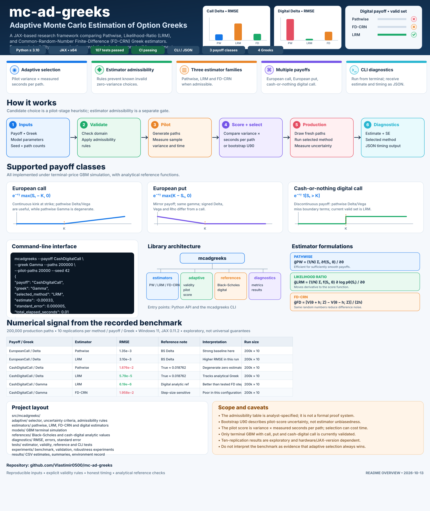
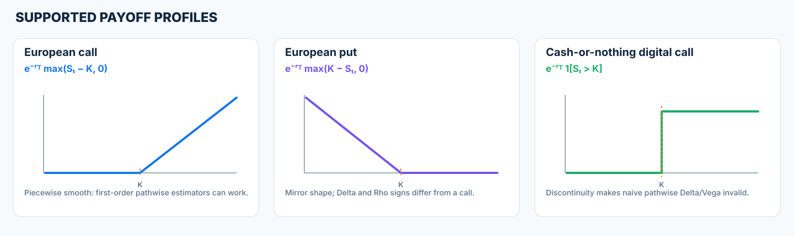
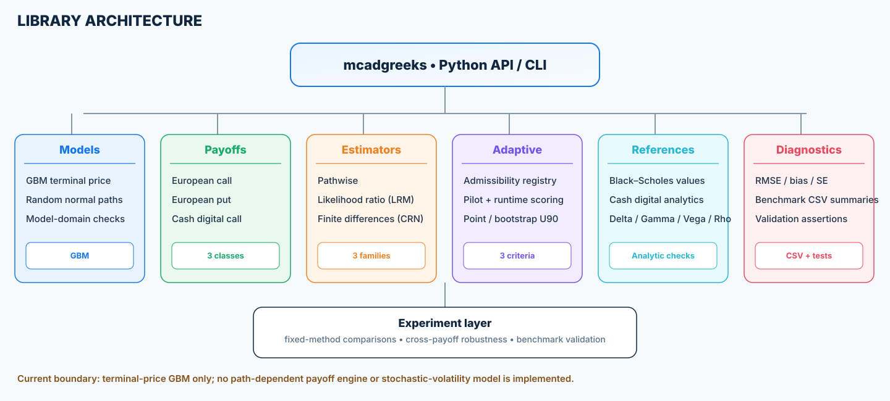
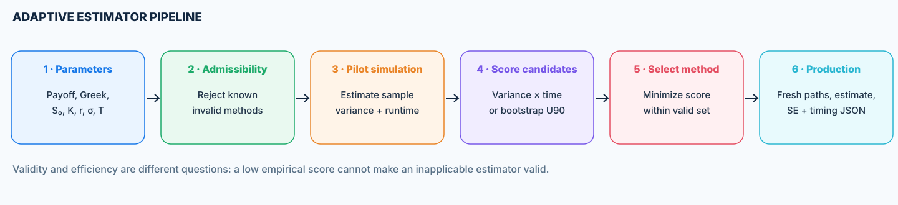
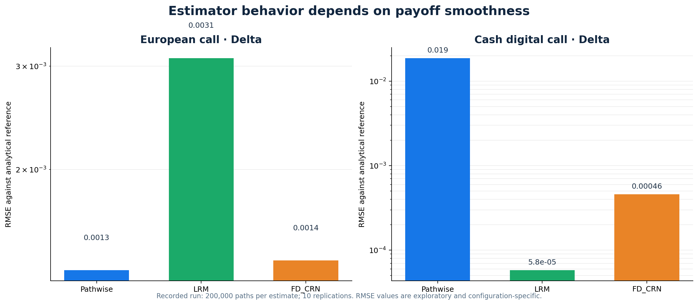

<div align="center">
  <h1>mc-ad-greeks</h1>
  <h3>Adaptive Monte Carlo Estimation of Option Greeks</h3>
  <p><strong>A JAX-powered research framework for estimator comparison, admissibility-aware selection, and reproducible numerical diagnostics.</strong></p>
  <p>
    <a href="https://github.com/Vlastimir0500/mc-ad-greeks/actions/workflows/tests.yml"></a>
    = 3.10">
    
    
    
    
  </p>
  <p><a href="#quick-start">Quick start</a> · <a href="#how-the-selector-works">Selector</a> · <a href="#numerical-results">Results</a> · <a href="#limitations">Limitations</a></p>
</div>

<p align="center">
  
</p>

> **Project status:** the implementation currently covers terminal-price GBM, three European-style payoff classes, four Greeks, a command-line interface, numerical tests, and a repeatable benchmark pipeline. Benchmark findings are exploratory: adaptive selection is not guaranteed to outperform a fixed estimator, and the validity registry is an explicit analyst-maintained rule set rather than a formal proof system.

---

## Table of contents

- [What this project does](#what-this-project-does)
- [Why estimator validity matters](#why-estimator-validity-matters)
- [Supported models, payoffs, and Greeks](#supported-models-payoffs-and-greeks)
- [Architecture](#architecture)
- [How the selector works](#how-the-selector-works)
- [Estimator families](#estimator-families)
- [Quick start](#quick-start)
- [Command-line interface](#command-line-interface)
- [Python API](#python-api)
- [Numerical results](#numerical-results)
- [Reproducing the benchmark](#reproducing-the-benchmark)
- [Tests and validation](#tests-and-validation)
- [Repository map](#repository-map)
- [Limitations](#limitations)
- [Next engineering milestones](#next-engineering-milestones)

## What this project does

`mc-ad-greeks` studies a practical question in Monte Carlo risk estimation:

**Given a payoff and a Greek, which estimator should be used when computational cost and mathematical applicability both matter?**

The library simulates terminal asset prices under geometric Brownian motion (GBM), computes option sensitivities, compares several estimator families, and includes an adaptive selector that scores candidate methods using pilot-sample variance and measured per-path runtime. A separate admissibility registry prevents the normal, validity-constrained selector from choosing known degenerate estimates for the payoff/Greek pairs covered by the rules.

The emphasis is not on claiming a universal “best” estimator. The work makes the trade-off observable and testable:

- **Numerical accuracy:** estimates are checked against analytical Black–Scholes or cash-digital references.
- **Estimator behavior:** Pathwise, Likelihood-Ratio Method (LRM), and Common-Random-Number Finite Differences (FD-CRN) are compared where implemented.
- **Applicability:** a zero empirical variance is not treated as proof of correctness.
- **Runtime accounting:** selection, production-shape warm-up, production execution, and total wall time are reported separately.
- **Reproducibility:** experiments emit CSV summaries and benchmark-validation assertions.

## Why estimator validity matters

Automatic differentiation follows the computation graph it is given. For a discontinuous payoff, differentiating a sampled indicator can return zero for almost every simulated path, even when the derivative of the *expectation* is nonzero. The estimator can therefore have zero sample variance and still be wrong.

For a cash-or-nothing digital call, the payoff is

\[
V_\text{digital}(S_T)=e^{-rT}\,\mathbf{1}\{S_T>K\}.
\]

The sampled indicator is locally constant except at the threshold. Naive pathwise Delta and Vega consequently miss the probability-boundary contribution. A variance-only selector can incorrectly prefer these degenerate samples because their measured variance is zero.

The repository treats **validity and efficiency as separate gates**:

1. The admissibility registry encodes the currently supported estimator choices for each payoff/Greek pair.
2. The selector scores candidates only after validity filtering for the normal `valid_point` and `valid_upper90` criteria.
3. The `unconstrained_point` criterion remains available for diagnostic experiments that reproduce failure modes; it should not be the default for production-like estimates.

The registry is deliberately explicit. It is an engineering guardrail backed by analytical checks and tests, not an automated symbolic proof of estimator correctness.

## Supported models, payoffs, and Greeks

### Model

The current simulation model is terminal-price GBM:

\[
S_T=S_0\exp\left[\left(r-\frac{1}{2}\sigma^2\right)T+\sigma\sqrt{T}Z\right],\qquad Z\sim\mathcal{N}(0,1).
\]

The model parameters are spot \(S_0\), strike \(K\), continuously compounded rate \(r\), volatility \(\sigma\), and maturity \(T\). Positive-domain parameters are validated before selector execution.

### Payoff profiles

<p align="center"></p>

| Payoff key | Definition before discounting | Analytical reference |
|---|---|---|
| `EuropeanCall` | \(\max(S_T-K,0)\) | Black–Scholes price and Greeks |
| `EuropeanPut` | \(\max(K-S_T,0)\) | Black–Scholes price and Greeks |
| `CashDigitalCall` | \(\mathbf{1}\{S_T>K\}\), unit cash payout | Cash-or-nothing digital price and Greeks |

### Greeks

| Greek | Risk meaning | Main issue tested here |
|---|---|---|
| **Delta** | Sensitivity to spot \(S_0\) | First-order pathwise works for smooth European payoffs; digital boundary terms break naive pathwise Delta. |
| **Gamma** | Second derivative with respect to spot | Naive pathwise second derivative can collapse to zero and miss the payoff kink/boundary contribution. |
| **Vega** | Sensitivity to volatility \(\sigma\) | Pathwise and LRM behavior differ; digital payoff discontinuity requires particular care. |
| **Rho** | Sensitivity to interest rate \(r\) | Includes both payoff-distribution and discount-factor effects. |

## Architecture

<p align="center"></p>

The implementation is organized into small modules so the estimators, validity rules, references, tests, and experiments can be inspected independently.

### Design boundaries

- `models/` generates terminal values from the GBM model.
- `payoffs/` defines basic call, put, and digital payoff functions.
- `estimators/` holds sample-level Pathwise, LRM, and finite-difference logic.
- `adaptive/` contains candidate timing, scoring, selection criteria, and admissibility rules.
- `references/` contains the analytical values used as ground truth for the tested model.
- `diagnostics/` contains error and uncertainty metrics.
- `experiments/` runs repeated comparisons and writes machine-readable results.
- `tests/` protects formulas, selector behavior, domain validation, CLI behavior, and known edge cases.

## How the selector works

<p align="center"></p>

### Candidate score

For a candidate estimator with pilot samples \(g_1,\ldots,g_m\), the selector computes sample variance \(\widehat{\operatorname{Var}}(g)\) and a warmed-JIT estimate of seconds per path \(\widehat{t}_{\text{path}}\). The point score is

\[
\widehat{J}=\widehat{\operatorname{Var}}(g)\,\widehat{t}_{\text{path}}.
\]

Lower is preferred *among admissible candidates*. This is a variance–runtime proxy, not a guaranteed estimate of finite-budget mean-squared error. It does not by itself account for bias, and a short pilot can mis-rank candidates.

### Selection criteria

| Criterion | Behavior | Appropriate interpretation |
|---|---|---|
| `unconstrained_point` | Minimizes the point score without applying the payoff/Greek validity registry. | Diagnostic control for illustrating why a naive variance-time optimizer can fail. |
| `valid_point` | Filters the candidates through the admissibility registry, then minimizes the point score. | Default practical selection path for the current supported set. |
| `valid_upper90` | Filters through the registry and ranks candidates by the bootstrap 90th-percentile variance-time score. | A pilot-score uncertainty heuristic; not a proof of unbiasedness or validity. |

Bootstrap resampling is applied to pilot samples to estimate variation in the score. The resulting upper percentile communicates uncertainty in the *pilot score*, not confidence that an estimator is mathematically valid.

### Current admissibility policy

| Payoff | Delta | Gamma | Vega | Rho |
|---|---|---|---|---|
| `EuropeanCall` | Pathwise / LRM / FD-CRN | LRM / FD-CRN | Pathwise / LRM / FD-CRN | Pathwise / LRM / FD-CRN |
| `EuropeanPut` | Pathwise / LRM / FD-CRN | LRM / FD-CRN | Pathwise / LRM / FD-CRN | Pathwise / LRM / FD-CRN |
| `CashDigitalCall` | LRM | LRM | LRM | LRM |

The table reflects the current repository policy. `Pathwise` is excluded for Gamma across the three payoff classes because the pathwise second derivative is degenerate under the implemented terminal payoff calculation. For the digital call, the current policy is deliberately stricter: LRM is the only admissible candidate for the four Greeks.

## Estimator families

### 1. Pathwise / pathwise differentiation

For sufficiently smooth payoffs, differentiation can be moved inside the expectation and propagated through the pathwise dependence on the parameter. In a schematic form,

\[
\widehat{G}_{\mathrm{PW}}=\frac{1}{N}\sum_{i=1}^{N}\frac{\partial V(S_T^{(i)},\theta)}{\partial\theta}.
\]

This can be low variance and computationally efficient when the regularity assumptions hold. A sampled non-smooth payoff can violate those assumptions for the desired derivative; differentiating the sampled expression is not always equivalent to differentiating the expectation.

### 2. Likelihood-Ratio Method (LRM)

LRM places the derivative on the probability density (score function), schematically,

\[
\widehat{G}_{\mathrm{LRM}}=\frac{1}{N}\sum_{i=1}^{N}V(S_T^{(i)},\theta)\,\frac{\partial\log p_\theta(S_T^{(i)})}{\partial\theta}.
\]

This can handle discontinuous payoffs because the derivative acts on the distribution rather than the discontinuous payoff indicator. Its variance can be higher than pathwise estimators for smooth payoffs, so it should be compared empirically rather than assumed to win everywhere.

### 3. Common-Random-Number Finite Differences (FD-CRN)

A central difference uses shared random numbers for the upper and lower parameter perturbations:

\[
\widehat{G}_{\mathrm{FD}}=\frac{\widehat{V}(\theta+h;Z)-\widehat{V}(\theta-h;Z)}{2h}.
\]

Common random numbers can reduce the variance of the difference, but results are sensitive to the step size. Gamma uses a second-difference estimator. For a digital payoff, finite differences may produce sparse or unstable pilot samples; the current admissibility policy therefore excludes FD-CRN for digital Greeks.

## Quick start

### Requirements

- Python **3.10+**
- A JAX installation compatible with your operating system and hardware
- The project dependencies declared in `pyproject.toml`

### Windows PowerShell

```powershell
git clone https://github.com/Vlastimir0500/mc-ad-greeks.git
Set-Location mc-ad-greeks

python -m venv .venv
.\.venv\Scripts\Activate.ps1
python -m pip install --upgrade pip
python -m pip install -e ".[dev]"

python -m pytest -q
```

If you already have the repository, activate its environment and run the `pip install -e ".[dev]"` command whenever package metadata or entry points change.

## Command-line interface

The `mcadgreeks` console command is registered in `pyproject.toml`; `python -m mcadgreeks` is also supported after installation.

### Example: digital Gamma

```powershell
mcadgreeks `
  --payoff CashDigitalCall `
  --greek Gamma `
  --paths 200000 `
  --pilot-paths 20000 `
  --criterion valid_point `
  --seed 42
```

### Example: European call Vega with an uncertainty-aware criterion

```powershell
python -m mcadgreeks `
  --payoff EuropeanCall `
  --greek Vega `
  --spot 100 `
  --strike 100 `
  --rate 0.05 `
  --volatility 0.20 `
  --maturity 1.0 `
  --paths 200000 `
  --pilot-paths 20000 `
  --criterion valid_upper90 `
  --bootstrap-replicates 60 `
  --seed 20261013
```

### CLI options

| Option | Choices / default | Meaning |
|---|---|---|
| `--payoff` | `EuropeanCall`, `EuropeanPut`, `CashDigitalCall` | Payoff family. |
| `--greek` | `Delta`, `Gamma`, `Vega`, `Rho` | Risk sensitivity. |
| `--spot` | `100.0` | Initial spot. |
| `--strike` | `100.0` | Strike. |
| `--rate` | `0.05` | Continuously compounded risk-free rate. |
| `--volatility` | `0.2` | Volatility; must be positive. |
| `--maturity` | `1.0` | Time to maturity; must be positive. |
| `--paths` | `100000` | Production simulation path count. |
| `--pilot-paths` | `20000` | Pilot path count used for selection. |
| `--criterion` | `valid_point` | One of the three criteria above. |
| `--seed` | `20261013` | Random key seed. |
| `--timing-repeats` | `3` | Repeats used to estimate steady-state candidate time. |
| `--bootstrap-replicates` | `60` | Bootstrap replicates for `valid_upper90`. |

### Output contract

The command prints JSON containing the payoff and Greek, model parameters, chosen method, selection criterion, point estimate, standard error, production path count, candidate scores, selection time, production-shape warm-up time, production execution time, and total elapsed time. Example values vary with the seed, software stack, and machine; the snippet below shows the structure only.

```json
{
  "payoff": "CashDigitalCall",
  "greek": "Gamma",
  "selected_method": "LRM",
  "criterion": "valid_point",
  "estimate": -0.00033,
  "standard_error": 0.000005,
  "production_paths": 200000,
  "selection_seconds": 0.002,
  "production_warmup_seconds": 0.001,
  "production_seconds": 0.003,
  "total_elapsed_seconds": 0.006,
  "candidates": []
}
```

The timing values above are illustrative formatting examples, not a promised runtime or a saved benchmark observation.

## Python API

```python
import jax

from mcadgreeks.adaptive.selector import estimate_greek

jax.config.update("jax_enable_x64", True)

parameters = (100.0, 100.0, 0.05, 0.20, 1.0)
key = jax.random.key(42)

result = estimate_greek(
    key,
    greek="Gamma",
    payoff="CashDigitalCall",
    parameters=parameters,
    n_paths=200_000,
    pilot_paths=20_000,
    criterion="valid_point",
)

print(result["selected_method"])
print(result["estimate"])
print(result["standard_error"])
print(result["total_elapsed_seconds"])
```

The current public function returns a dictionary containing the selected method, estimate, standard error, candidate pilot diagnostics, selection time, production warm-up time, production runtime, total elapsed time, and production path count.

## Numerical results

<p align="center"></p>

The repository records a benchmark with **200,000 production paths per estimate** and **10 independent replications per payoff/Greek/method combination**. The recorded files contain 480 estimate rows and 48 aggregated summary rows across three payoff classes, four Greeks, three fixed methods, and the adaptive-selected method.

### A particularly important failure mode

The recorded benchmark gives the following illustrative fixed-estimator RMSE values:

| Payoff / Greek | Pathwise RMSE | LRM RMSE | FD-CRN RMSE |
|---|---:|---:|---:|
| European call / Delta | 1.35 × 10⁻³ | 3.10 × 10⁻³ | 1.40 × 10⁻³ |
| Cash digital call / Delta | 1.876 × 10⁻² | 5.79 × 10⁻⁵ | 4.58 × 10⁻⁴ |
| Cash digital call / Gamma | 3.28 × 10⁻⁴ | 6.19 × 10⁻⁶ | 1.958 × 10⁻² |

These numbers are from one specific recorded configuration, not universal rankings. They demonstrate the project’s central engineering point: the estimator with the lowest sample variance or simplest computation is not necessarily the estimator that correctly estimates the target Greek. The fixed digital Pathwise estimates are included as a diagnostic comparator; the current validity table excludes them from normal adaptive selection.

### Runtime interpretation

The experiments report selection, production-shape warm-up, production execution, and total elapsed time separately. Timings are hardware-, JAX-version-, compilation-, and path-count-dependent. The variance-time point score uses a pilot estimate of steady-state seconds per path, while the final estimate must still pay the cost of running the selector. Therefore, use the total elapsed field for end-to-end comparisons; do not infer a speedup from the kernel timing alone.

## Reproducing the benchmark

Run the recorded benchmark pipeline from the repository root:

```powershell
python experiments/adaptive_estimator.py
python experiments/validate_benchmark.py
```

The benchmark script writes:

- `results/adaptive_estimator_benchmark.csv` — per-replication estimates, standard errors, selection method, and timing fields.
- `results/adaptive_estimator_summary.csv` — mean estimate, bias, RMSE, absolute error, standard error, and timing summaries.
- `results/adaptive_benchmark_environment.txt` — Python, platform, JAX, NumPy, pandas, path counts, and validation marker.

The benchmark uses fixed seeds for reproducibility. Exact timing numbers should still be expected to vary between systems. Re-running the script overwrites the generated benchmark output files.

## Tests and validation

The test suite exercises:

- analytical Black–Scholes and cash-digital reference values;
- finite sample outputs and stochastic estimator agreement within Monte Carlo tolerances;
- estimator admissibility for each payoff/Greek pair;
- the degenerate digital Pathwise failure case;
- Gamma LRM estimates against analytical references;
- input-domain and path-count validation;
- selection criteria and bootstrap-score handling;
- CLI JSON output and unsupported-option handling.

Run all tests with:

```powershell
python -m pytest -q
```

The project’s GitHub Actions workflow runs tests, executes the adaptive benchmark, validates generated results, and uploads benchmark CSV and environment artifacts. The status badge at the top of this README tracks the workflow on `main`.

## Repository map

```text
mc-ad-greeks/
├── .github/workflows/tests.yml
├── docs/images/
│   ├── overview.svg
│   ├── adaptive-workflow.svg
│   ├── architecture.svg
│   ├── payoff-profiles.svg
│   ├── benchmark-rmse.svg
│   └── benchmark-rmse.png
├── experiments/
│   ├── adaptive_estimator.py
│   ├── cross_payoff_robustness.py
│   ├── digital_all_greeks.py
│   ├── digital_validity.py
│   ├── equal_budget_comparison.py
│   ├── phase1.py
│   ├── phase2_fd_vs_ad.py
│   ├── uncertainty_selection.py
│   ├── validity_regret.py
│   └── validate_benchmark.py
├── results/
│   ├── adaptive_estimator_benchmark.csv
│   ├── adaptive_estimator_summary.csv
│   ├── adaptive_benchmark_environment.txt
│   └── additional experiment CSVs
├── src/mcadgreeks/
│   ├── adaptive/
│   ├── diagnostics/
│   ├── estimators/
│   ├── models/
│   ├── payoffs/
│   ├── references/
│   ├── cli.py
│   └── __main__.py
├── tests/
├── pyproject.toml
└── PROJECT_STATUS.txt
```

## Limitations

1. **Finite model scope.** Current validation covers a GBM terminal-price model with European call, European put, and cash-or-nothing digital call payoffs. It does not currently implement Heston, SABR, Asian options, barrier options, American exercise, or path-dependent simulation.
2. **Validity is encoded, not proved.** The admissibility registry reflects tested/analyst-identified applicability. It is not a type system, theorem prover, or automatic regularity analyzer.
3. **Pilot ranking can be noisy.** A small pilot can misestimate variance and runtime. The bootstrap upper-90 criterion measures score uncertainty, but cannot certify unbiasedness or estimator validity.
4. **Bias is distinct from variance.** Variance × time is a useful engineering heuristic, not a complete finite-budget mean-squared-error guarantee. The best variance-time score need not produce the lowest RMSE.
5. **Timing depends on environment.** JAX compilation, device placement, host synchronization, array size, and runtime versions influence measurements. Warm-up is reported separately to avoid hiding it.
6. **Exploratory replication count.** The current full benchmark uses ten replications per group; larger replication counts and independent parameter grids are appropriate before drawing strong statistical conclusions.

## Next engineering milestones

- Re-run and archive benchmark outputs after every change to estimator admissibility or selection logic.
- Expand parameter-grid calibration across moneyness, volatility, maturity, rate, and payoff regimes.
- Increase independent Monte Carlo replications and report uncertainty intervals around RMSE and selection frequencies.
- Compare full end-to-end fixed and adaptive policies under explicitly matched wall-clock budgets.
- Add structured payoff/Greek metadata so validity constraints can be validated more systematically.
- Extend beyond terminal GBM only after the current estimator correctness and timing contracts are stable.

## Citation and attribution

This repository is an engineering and numerical-experiment project. The methods implemented here—pathwise differentiation, likelihood-ratio estimation, finite differences, and Black–Scholes references—are established techniques. The project should be described as an experimental framework for comparing and selecting estimators under explicit validity rules, not as inventing those underlying methods.

---

<div align="center">
  <strong>Correctness before clever selection. Measured runtime before performance claims.</strong><br>
  <sub>Built with Python, JAX, NumPy, SciPy, pandas, and pytest.</sub>
</div>
